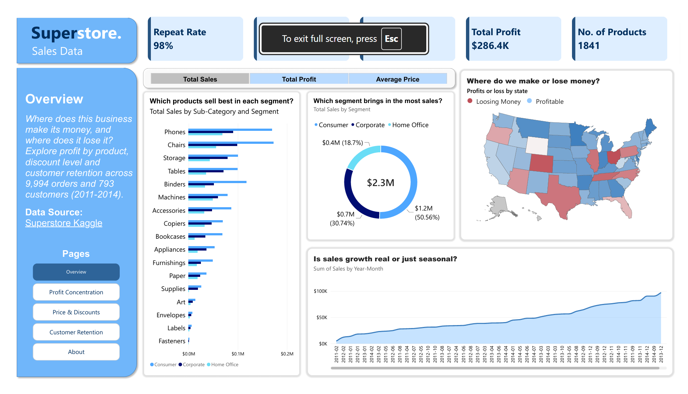
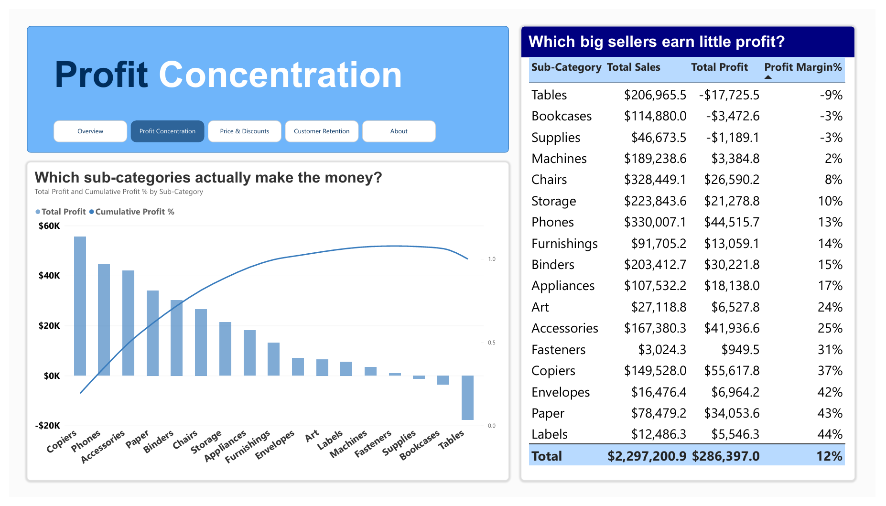
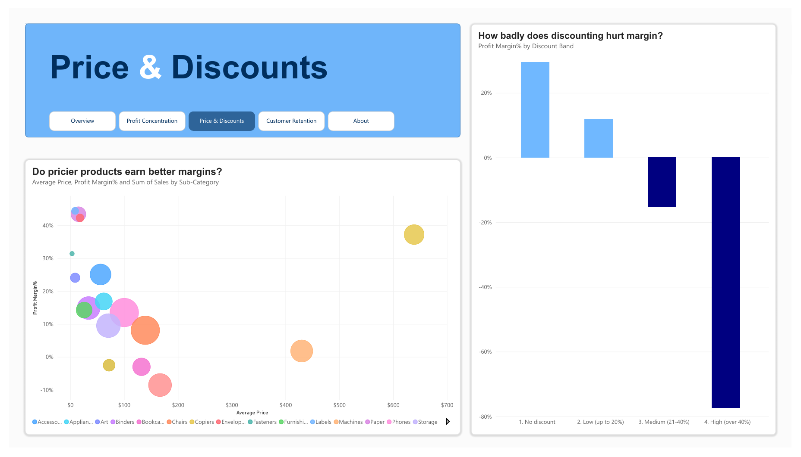
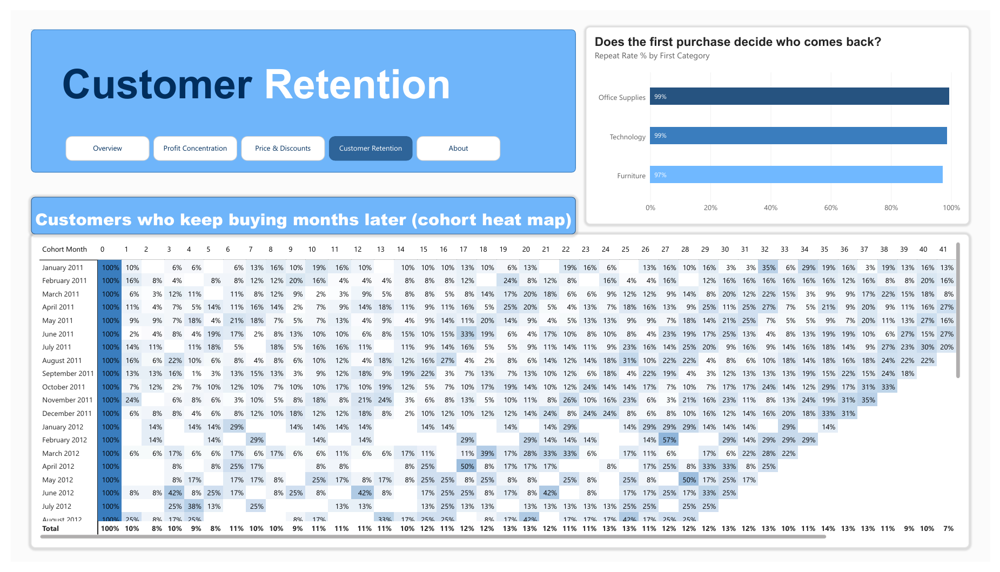
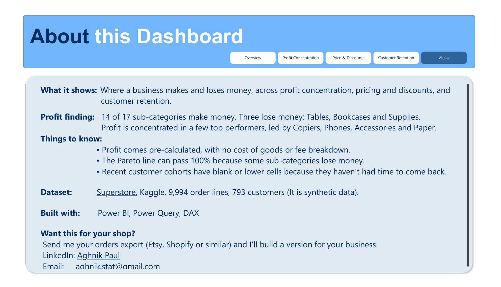

# Superstore Sales Analysis: Power BI Dashboard

**Where does this business make its money, and where does it lose it?**

An interactive Power BI dashboard that answers three questions an ecommerce owner can check from a standard orders export: where profit is concentrated, how pricing and discounts affect margin, and how well customers keep coming back.

> **Demo data.** This project uses the Tableau Superstore sample dataset. It is fictional and is not data from a real Etsy or Shopify shop. The same approach works on a real orders export.



---

## Business questions

| Page | Question it answers |
|---|---|
| **Overview** | How is the business performing overall, and where are the profitable and loss-making states? |
| **Profit Concentration** | Which sub-categories actually make the money, and which big sellers earn little? |
| **Price & Discounts** | Do pricier products earn better margins, and how badly does discounting hurt? |
| **Customer Retention** | How many customers keep buying months after their first order? |
| **About** | Data source, caveats and contact details |

---

## Key findings

- **Scale:** about $2.30M in sales, $286.4K in profit, a 12% overall margin, across 9,994 order lines and 793 customers.
- **Profit is concentrated.** 14 of 17 sub-categories make money, led by Copiers, Phones, Accessories and Paper. A small group of sub-categories drives most of the profit. *(Confirm the exact number of sub-categories needed to reach 80% from the Pareto chart and add it here.)*
- **Three sub-categories lose money:** Tables, Bookcases and Supplies. Tables is the largest loss at roughly -$17.7K despite $207K in sales.
- **Discounting is where margin turns negative.** Orders with no discount earn roughly a 29% margin, and low discounts (up to 20%) about 12%. Medium discounts (21-40%) are loss-making, and discounts over 40% lose heavily.
- **Most customers come back, but slowly.** The repeat rate is 98%, yet in the cohort heat map only around 10% of a cohort is active in any single later month. Retention here is about purchase frequency, not one-time buyers.

---

## Dashboard pages

### Overview
KPI cards (repeat rate, customers, sales, profit, products), profit margin by state, sales by segment, and a toggle for Total Sales, Total Profit and Average Price.


### Profit Concentration
A Pareto chart of profit by sub-category with a cumulative profit % line, plus a table that ranks sub-categories by sales next to profit and margin. The cumulative line passes 100% and then falls back because some sub-categories lose money.



### Price & Discounts
A scatter plot of average price against profit margin (bubble size = sales) and a column chart of margin by discount band.



### Customer Retention
A cohort heat map (first-purchase month against months since first purchase) and repeat rate by first purchase category.



### About
Data source, caveats and a call to action.



---

## Dataset

- **Source:** Superstore sample dataset (Kaggle). Link: https://www.kaggle.com/datasets/ishanshrivastava28/superstore-sales
- **License:** Database: Open Database, Contents: Database Contents (ODbL)
- **Size:** 9,994 rows, 21 columns
- **Date range:** Min: January 3, 2011 (03-01-2011), Max: December 30, 2014 (30-12-2014)
- **Format:** single CSV, loaded in Power Query

### Columns used
Order Date, Ship Date, Customer ID, Customer Name, Segment, Country, City, State, Postal Code, Region, Product ID, Category, Sub-Category, Product Name, Sales, Quantity, Discount, Profit. Order ID is also used for the repeat-customer measure.

### Data preparation (Power Query)
- Loaded the CSV directly, using Western European (1252) encoding.
- Order Date arrived as text in day-month-year format. It was converted to a Date type using the English (United Kingdom) locale. The format was checked first by confirming that no value exceeded 12 in the second position.
- Set the State column's data category to *State or Province* so the filled map plots correctly.

---

## How to open

1. Install the latest **Power BI Desktop** (free, Windows).
2. Download `Superstore.pbix` from this repository. `[update the filename]`
3. Open it in Power BI Desktop. The data is embedded, so nothing else is needed.

A PDF export of every page is in the `/report` folder for quick viewing without Power BI.

---

## DAX

### Measures

```dax
Total Sales = SUM(Superstore[Sales])

Total Profit = SUM(Superstore[Profit])

Profit Margin% = DIVIDE(SUM(Superstore[Profit]), SUM(Superstore[Sales]))

Average Price = DIVIDE(SUM(Superstore[Sales]), SUM(Superstore[Quantity]))

Customers = DISTINCTCOUNT(Superstore[Customer ID])

Active Customers = DISTINCTCOUNT(Superstore[Customer ID])

Repeat Customers =
COUNTROWS(
    FILTER(
        VALUES(Superstore[Customer ID]),
        CALCULATE(DISTINCTCOUNT(Superstore[Order ID])) > 1
    )
)

Repeat Rate % = DIVIDE([Repeat Customers], [Customers])

Cohort Size =
CALCULATE(
    DISTINCTCOUNT(Superstore[Customer ID]),
    ALLEXCEPT(Superstore, Superstore[Cohort Month])
)

Cohort Retention % = DIVIDE([Active Customers], [Cohort Size])

Cumulative Profit % =
VAR CurrentProfit = [Total Profit]
VAR AllSubCats = ALL(Superstore[Sub-Category])
VAR RunningTotal =
    SUMX(
        FILTER(AllSubCats, [Total Profit] >= CurrentProfit),
        [Total Profit]
    )
RETURN
    DIVIDE(RunningTotal, CALCULATE([Total Profit], ALL(Superstore)))
```

### Metric toggle (field parameter)

```dax
Metrics = {
    ("Total Sales", NAMEOF('Superstore'[Total Sales]), 0),
    ("Total Profit", NAMEOF('Superstore'[Total Profit]), 1),
    ("Average Price", NAMEOF('Superstore'[Average Price]), 2)
}
```

### Calculated columns

```dax
First Order Date =
CALCULATE(
    MIN(Superstore[Order Date]),
    ALLEXCEPT(Superstore, Superstore[Customer ID])
)

Cohort Month =
DATE(YEAR(Superstore[First Order Date]), MONTH(Superstore[First Order Date]), 1)

Months Since First =
DATEDIFF(Superstore[First Order Date], Superstore[Order Date], MONTH)

First Category =
VAR Cust = Superstore[Customer ID]
VAR CustFirstOrder = Superstore[First Order Date]
RETURN
    MINX(
        FILTER(
            ALL(Superstore),
            Superstore[Customer ID] = Cust
                && Superstore[Order Date] = CustFirstOrder
        ),
        Superstore[Category]
    )

Discount Band =
SWITCH(
    TRUE(),
    Superstore[Discount] = 0, "1. No discount",
    Superstore[Discount] <= 0.2, "2. Low (up to 20%)",
    Superstore[Discount] <= 0.4, "3. Medium (21-40%)",
    "4. High (over 40%)"
)

Year-Month = FORMAT(Superstore[Order Date], "yyyy-mm")
```

---

## Limitations

- **Demo data.** Superstore is a fictional sample, so findings describe this dataset, not real market behavior.
- **Profit is pre-calculated.** There is no cost of goods, shipping or fee breakdown, so margin assumptions cannot be edited.
- **Pareto line above 100%.** Loss-making sub-categories pull cumulative profit back down after it peaks.
- **Recent cohorts look worse.** They have had less time to return, so their right-hand cells are blank or low.
- **Repeat rate is high** (98%), which is unusual for real shops and a sign the sample is synthetic.

---

## Tools

Power BI Desktop, Power Query (M), DAX

---

## Want this for your shop?

Send me your orders export (Etsy, Shopify or other businesses) and I'll build a version for your business.

- LinkedIn:  https://www.linkedin.com/in/aghnikpaul
- Portfolio: https://aghnikpaul.page.gd
